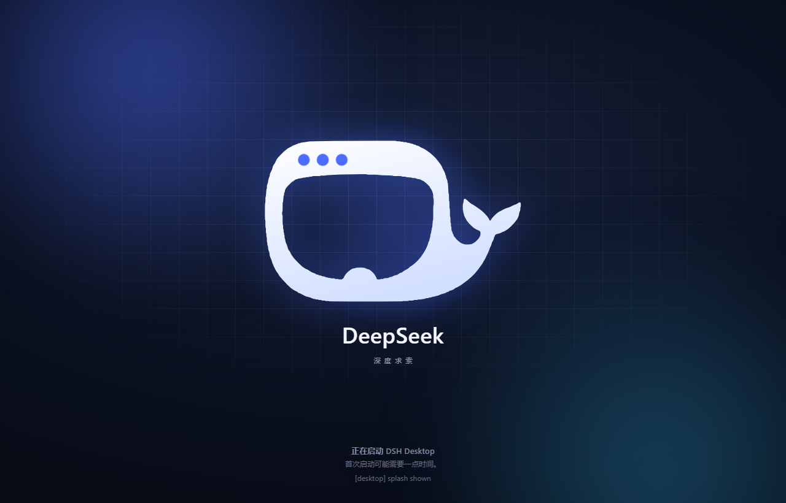
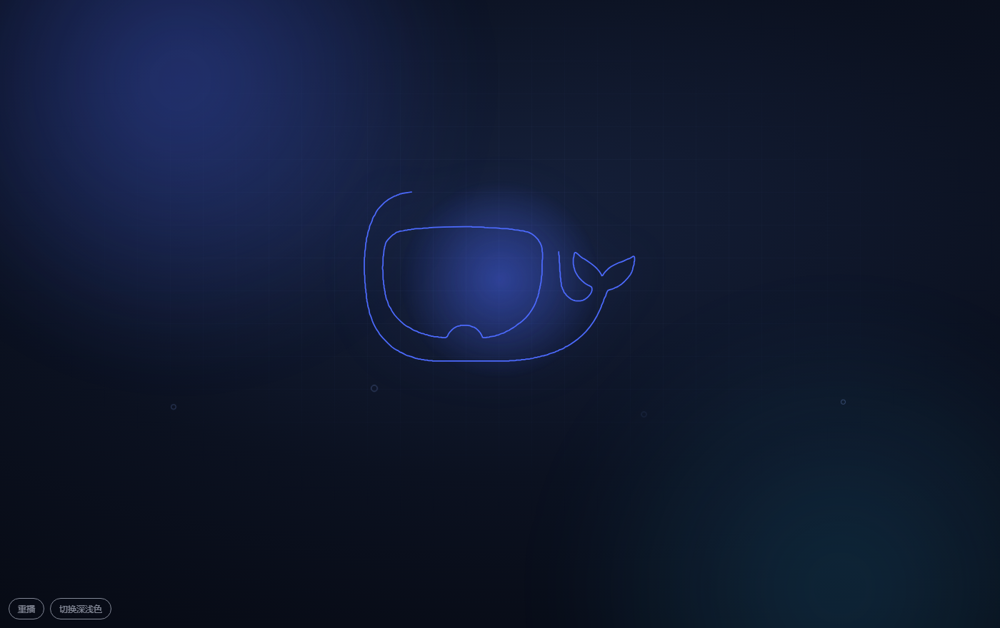
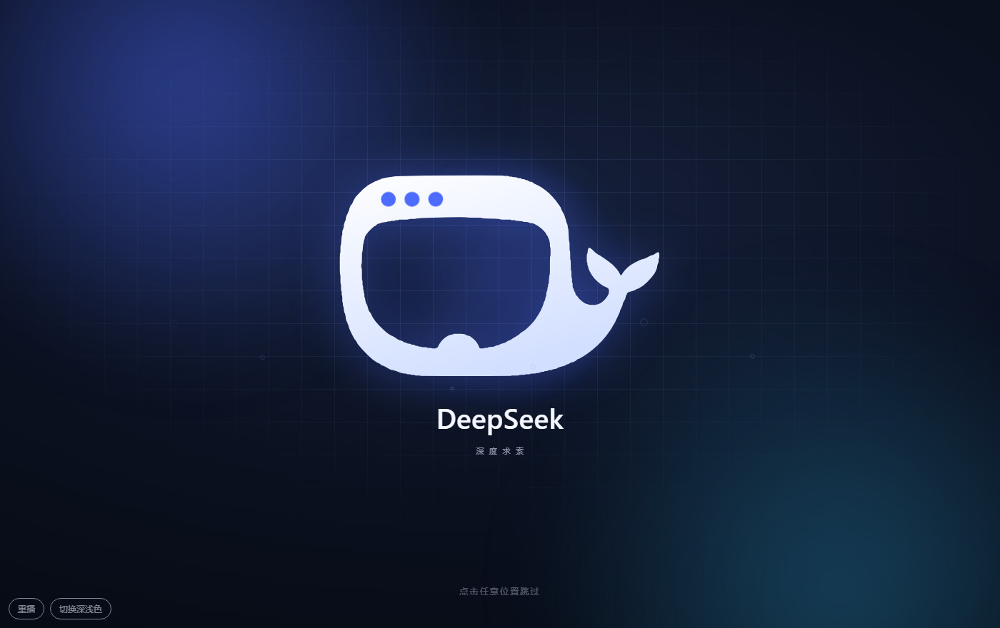
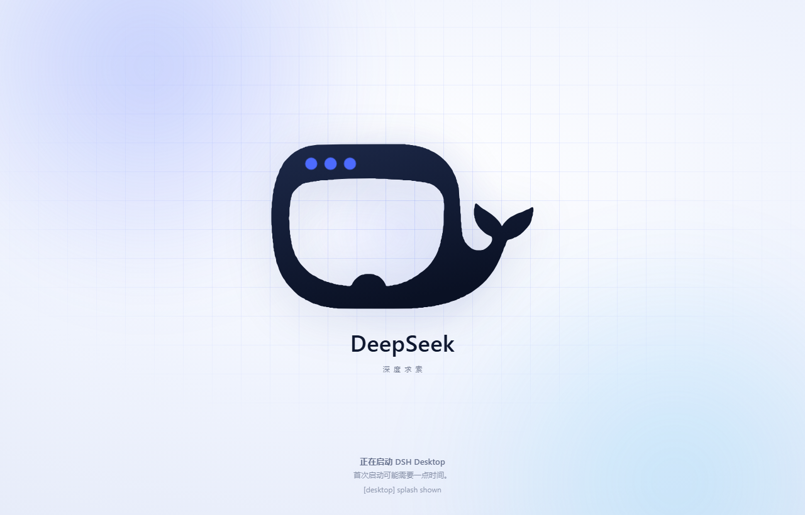

# dsh-deepseek-splash

DeepSeek 开屏动画 —— **点开软件的第一眼** 就是这段鲸鱼片头。

<p align="center">
  
</p>

> DeepSeek opening animation for DeepSeek Harness — the whale line-draw / signal-dots / fill /
> wordmark intro, rendered as DSH Desktop's own launch screen, with the same animation available
> as an opt-in full-screen client overlay (a plain DSH client plugin).

默认只放桌面版的启动画面那一次；进界面那次浮层是静音的（紧接着又放一遍读起来像卡带），
需要时一行配置就能让它回来。

同一套动画有两个落点，共用一份视觉源码（`src/splash.css` + `assets/whale.svg`）：

| 落点 | 载体 | 出现时机 |
| --- | --- | --- |
| **启动画面** | DSH Desktop 自己的 `resources/splash.html`（首次由 `tools/build_splash.py --apply` 写入，之后由宿主半边在启动时自动装回） | 双击图标、窗口刚出现就播；播完鲸鱼保持点亮，三颗信号点持续脉动当作加载指示，直到应用切到界面 |
| **界面开屏**（默认静音） | 本插件的 `shell.overlay` 浮层（客户端半边） | 需要显式 opt in；开启后界面加载完成时整窗播放一次，约 2.8 秒 |

动画本身四拍：

1. **描边**：蓝色高光沿着鲸鱼轮廓逐段画出（`pathLength=1` + `stroke-dashoffset`），
   屏幕与尾鳍同时被"勾"出来；
2. **点灯**：鲸鱼头顶的三颗信号点依次亮起并回弹，随后进入呼吸式脉动；
3. **成形**：填充自左向右涌入，白光扫过一遍，描边淡出，鲸鱼轻轻落定；
4. **落款**：`DeepSeek` 字标上浮、`深 度 求 索` 副标淡入；
5. **散场**（仅界面开屏）：整幕淡出并卸载，把界面交还给应用。

深浅两套主题都跟随外壳（`<html data-theme>`：桌面版按 `?theme=` 传进来，
GUI 里读外壳自己的主题），并尊重 `prefers-reduced-motion`（此时只保留一次极简淡入）。

## 交互

界面开屏（浮层，**默认静音**）：

启动画面已经在打开软件时放过同一段动画，紧接着进界面又放一遍，读起来是卡带而不是欢迎。
所以浮层默认什么都不渲染；确实想在 GUI 里也看到它时（在普通浏览器里打开界面、或者就是想看第二遍），
在页面里 opt in 一次即可：

```js
window.__DSS_SPLASH__ = { overlay: true };   // 或 { disabled: false }
```

开启之后：

- **随时跳过**：点击 / 触摸任意位置，或按任意键，立刻结束动画。
- **自动收场**：无论动画是否被打断，CSS 都会在约 2.9 秒后把浮层淡出，
  即使脚本异常也不会挡住界面。
- **只在首屏播放**：同一标签页内的后续路由切换不会再放。
- **可见即播**：窗口一旦可见就拉开帷幕，**不要求窗口拿到焦点**——桌面版
  抬窗口时是"不抢焦点"的，等一次没人点的点击就等于永远不放。

启动画面（桌面版 splash）：

- **不可跳过**：它背后还没有可以交还的界面，所以点击 / 按键都不会把它关掉。
- **一直亮着**：鲸鱼成形后停在终态，三颗点继续脉动，直到应用把窗口切到界面。
- **启动文案**：标题与副标题沿用官方文案并跟随系统语言切中文。DSH Desktop 0.12.1
  仍然只往 `#title` / `#status` 里写启动信息，**不再写 `#progress`**
  （页面保留这个空元素，好让 0.11 及更早的启动器继续有地方写）。

## 桌面启动画面的安装与还原

```
py -3 tools/build_splash.py --apply     # 渲染并写入 DSH Desktop 的 resources/splash.html
py -3 tools/build_splash.py --status    # 看目标文件现在装的是哪一版、启动器是什么版本
py -3 tools/build_splash.py --restore   # 还原官方页面，并让插件以后别再装回来
```

- **目标路径自动探测**：`DSH_DESKTOP_RESOURCES` 环境变量 > `D:\deepseek\Data\DSH Desktop\resources`
  > `%LOCALAPPDATA%\Programs\dsh-desktop\resources` > `%ProgramFiles%\dsh-desktop\resources`；
  都不对时用 `--target <路径>` 指定。`--status` 会打印识别到的启动器版本（如 `0.12.1`）。
- 首次 `--apply` 会把官方页面原样备份成 `splash.html.dsh-deepseek-splash.bak`
  （之后不会覆盖这份原版备份，即使外壳自己又更新了一版）。
- **桌面更新会覆盖 `splash.html`，插件会自己装回来**：宿主半边在每次启动时检查一遍，
  发现装的是官方页面就重新写入（这是 1.1.0 的主要改动，见下）。
  想彻底关掉这个自动行为，用 `--restore`——它会写一个
  `splash.html.dsh-deepseek-splash.revoked` 标记，插件看到标记就不再动这个文件；
  `--apply` 会清掉标记。
- 页面完全自包含（内联样式 + 内联 SVG，无外部图片、无联网）。

## 预览

| 描边自绘 | 界面浮层（暗色） | 启动画面（亮色） |
| --- | --- | --- |
|  |  |  |

- `docs/preview.gif` —— 整段动画的逐帧预览（20 帧）。
- `assets/preview.html` —— 免安装预览页，直接用浏览器打开即可；
  地址栏加 `#t=1300` 可以停在动画的第 1300 毫秒。
- `dist/splash.html` —— 启动画面的渲染产物，也能直接用浏览器打开
  （加 `?theme=light` 看浅色）。

## 配置与诊断

页面里（控制台或 `window.__DSS_SPLASH__`）可以覆盖任意参数：

```js
window.__DSS_SPLASH__ = {
  overlay: true,           // 界面开屏那次也放（默认静音，只在桌面启动画面放）
  disabled: true,          // 本次加载不放动画
  holdMs: 2760,            // 定格时长
  title: "DeepSeek",       // 主字标
  subtitle: "深度求索",     // 副标（给空串则隐藏）
  hint: "点击任意位置跳过"
};
```

动画状态写在 `<html data-dss-splash>` 上：`waiting`（窗口还没可见，帷幕待命）、
`playing`（幕布放下）、`done`（已收场）、`skipped`（本次加载没有播放）。
样式表本身是 `<style id="dss-splash-style">`，两者都可以用来确认插件是否真的加载了。
启动画面里同样的东西挂在 `window.__DSS_LAUNCH_SPLASH__`。

## 测试

```
node tools/smoke_client.mjs       # 客户端 bundle 的注册契约（13 项，含"默认静音"约定，无需浏览器）
node tools/smoke_host.mjs         # 宿主半边的装回逻辑（12 项：备份只留一次、revoked 生效、
                                  #   已是自己时不重写、没有启动页时不越界；全在临时目录里跑）
py -3 tools/build_splash.py       # 渲染启动画面并校验外壳契约（#title/#status、无外链图片）
```

Windows 上 `python` 有时只是应用商店的空壳，用 `py -3`；`npm test` 会跑前两项。

## 安装

插件是一个普通的 DSH 客户端插件包，装进某个 profile 即可：

```bash
# 直接从这个仓库装（npm 的 git 规格）
dsh plugin --profile web add "github:zhang-23x/dsh-deepseek-splash"

# 或者先克隆，再按本地目录装（link: 规格）
git clone https://github.com/zhang-23x/dsh-deepseek-splash
dsh plugin --profile web add "link:/绝对/路径/dsh-deepseek-splash"
```

DSH Desktop 里也可以直接用插件管理装本地目录（不依赖 CLI）。
装完刷新界面即可（客户端 bundle 在页面加载时注入）。

**桌面启动画面**那半不用再手工装：宿主半边随插件启动，在检测到 DSH Desktop 安装、
且 `resources/splash.html` 还不是本插件的页面时自动写一次（官方页面同时被备份成
`*.dsh-deepseek-splash.bak`）。也就是说装完重启一次 DSH Desktop，开屏就是这条鲸鱼；
以后桌面版更新把它覆盖掉，下次启动也会自己回来。想手工确认或提前装：

```
py -3 tools/build_splash.py --status    # 看识别到的启动器、目标文件、备份
py -3 tools/build_splash.py --apply     # 立即渲染并写入
```

已验证的适配基线：**DSH Desktop 0.12.1**（harness `0.2.1-rc.2`）；0.11 及更早同样可用。

## 结构

```
package.json             dsh.bundle.patch + dsh.client.platform=web（files 含 dist/，装回时要用）
cordis.patch.yml         宿主插件行（id: deepseek-splash）
lib/index.js             宿主半边：在 DSH Desktop 安装里装回启动画面（无服务、无工具、不联网）
lib/client.js            客户端半边（构建产物，勿手改）
src/splash.css           视觉与时间轴（全部动画都在这里）
src/splash.js            标记生成 / 主题读取 / 跳过与收场（两个落点共用）
src/overlay.js           极小的 React 挂载层（shell.overlay 插槽、默认静音开关、可见性把关）
src/desktop-splash.html  启动画面页面模板
src/desktop-splash.css   启动画面的外壳样式（背景、启动信息块）
src/desktop-splash.js    启动画面引导（不可跳过、长驻、复用同一套动画）
assets/whale.svg         鲸鱼矢量图（由 tools/trace_whale.py 从官方图标描出）
assets/preview.html      免安装预览页（用浏览器直接打开）
dist/splash.html         启动画面渲染产物（宿主半边装的就是这一份）
tools/smoke_host.mjs     宿主半边测试（临时目录，不写真实安装）
tools/                   素材与构建脚本
```

## 重新构建

```
python tools/trace_whale.py              # 官方 icon.png -> assets/whale.svg
python tools/build_client.py             # src/* -> lib/client.js + assets/preview.html
python tools/build_splash.py --apply     # src/desktop-splash.* -> 桌面版启动画面
```

## 说明

插件不注册服务、不加工具、不联网。它做两件事：

1. 注册一个 `shell.overlay` 插槽给界面开屏用，而浮层默认不渲染任何东西
   （动画在桌面启动画面里放），插件侧的开销为零；
2. 在 DSH Desktop 里跑时检查一次 `resources/splash.html`：如果不是本插件的页面就写回去
   （原页面留一份 `.dsh-deepseek-splash.bak` 备份），如果是就什么都不做。
   这是 1.1.0 起的行为——桌面更新会覆盖启动页，靠它才能自动恢复。

不想要这次写入时，`--restore` 会写 `.dsh-deepseek-splash.revoked` 标记并还原官方页面，
插件此后不再动它；`--apply` 清掉标记。除这一个文件（和它的备份/标记）之外，
插件不写任何东西。

## License

[MIT](LICENSE) © 2026 zhang-23x
